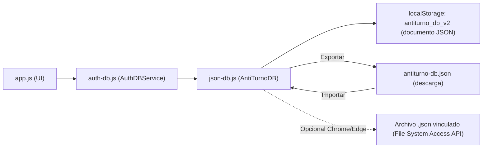

# Plan 02 · Registro, inicio de sesión y base de datos JSON

> Origen: *Primera versión de mi aplicación.docx* → **"Después de crear mi usuario, cuando intento ingresar nuevamente, el correo no aparece guardado."**
> Decisión del equipo: **usar una base de datos en formato JSON** para usuarios y turnos, sin crear cuentas en servicios externos (Supabase / Firebase).

## 1. Diagnóstico (causas encontradas)

| # | Causa | Evidencia |
|---|---|---|
| 1 | Los inputs **no tienen `name` ni `autocomplete`**, así que el navegador no reconoce el formulario como login y no ofrece guardar/autocompletar el correo ni la contraseña. | `index.html` L896, L901, L924, L929, L934, L939. |
| 2 | La app **no recuerda el último correo usado**: al cerrar sesión se borra la sesión y el campo de correo queda vacío siempre. | `handleLoginSubmit` / `logout` (app.js L242, auth-db.js L527). |
| 3 | Tras **registrarse**, el correo no se copia al formulario de login y el navegador no ofrece "¿Guardar contraseña?". | `handleRegisterSubmit` (app.js L275). |
| 4 | Los datos están **dispersos en 4 claves** de `localStorage` (`cuidadosync_users_v1`, `_shifts_v1`, `_commitments_v1`, `_session_v1`) sin estructura única, sin versión y sin forma de respaldarlos o moverlos a otro dispositivo. | `auth-db.js` L12‑L16. |
| 5 | Existe código de **Firebase** (SDK cargado desde CDN, modal de configuración, sincronización) que **no se usa** (`firebase-config.js` vacío) y añade peso y complejidad. | `index.html` L1068‑L1073; `auth-db.js` L34‑L206; app.js `openCloudConfigModal`. |
| 6 | Detalles menores: `logout()` es `async` pero no se espera; no hay botón para ver la contraseña; labels sin `for`. | app.js L317‑L329. |

## 2. Objetivos

1. Una **base de datos JSON única** (`AntiTurnoDB`) con usuarios, turnos, compromisos y preferencias, versionada y con migración automática de los datos actuales.
2. Poder **exportar / importar** la base de datos como archivo `antiturno-db.json` (respaldo y paso de datos entre dispositivos).
3. En PC (Chrome/Edge): opción de **vincular un archivo `.json` local** para que la app lea y guarde automáticamente en él.
4. Al volver a la app, el **correo aparece prellenado** y el navegador ofrece **autocompletar** correo y contraseña.
5. Eliminar la dependencia de Firebase sin perder ninguna función existente.

## 3. Arquitectura de la base de datos JSON

> [!IMPORTANT]
> La app está publicada en **GitHub Pages** (sitio estático): el navegador **no puede escribir** archivos en el servidor. Por eso la base JSON vive en el navegador (persistida en `localStorage`) y se puede **guardar / cargar como archivo `.json`**. No hay sincronización automática entre dispositivos; se hace exportando e importando el archivo.



### 3.1 Esquema del documento (`data/db.schema.example.json`)
```json
{
  "app": "AntiTurno",
  "version": 2,
  "updatedAt": "2026-11-01T00:00:00.000Z",
  "users": [
    {
      "id": "usr_...",
      "name": "Karol Gallo",
      "email": "karol@hospital.com",
      "salt": "hex...",
      "hash": "pbkdf2_subtle_...",
      "createdAt": "ISO",
      "settings": { "rememberEmail": true, "reminderPrefs": {} }
    }
  ],
  "shifts": [
    {
      "id": "shf_...", "userId": "usr_...",
      "date": "2026-11-03", "startTime": "07:00", "endTime": "15:00",
      "type": "M", "hospital": "", "service": "", "notes": "",
      "reminders": [], "createdAt": "ISO", "updatedAt": "ISO"
    }
  ],
  "commitments": [
    {
      "id": "com_...", "userId": "usr_...", "title": "", "category": "otro",
      "date": "", "startTime": "", "endTime": "", "location": "", "notes": "",
      "reminders": [], "createdAt": "ISO", "updatedAt": "ISO"
    }
  ]
}
```
- La **sesión** (`antiturno_session_v2`) y el **último correo** (`antiturno_last_email_v1`) se guardan aparte: no son datos de la base y no deben exportarse.
- Las contraseñas **nunca** se guardan en texto plano: se mantiene PBKDF2‑SHA256 (100.000 iteraciones + salt) ya implementado.
- Se incluye en el repo solo un **archivo de ejemplo sin datos reales** (`data/db.schema.example.json`). Se añade `data/*.json` (excepto el ejemplo) a `.gitignore` para no publicar hashes de usuarios.

### 3.2 Nuevo `js/json-db.js` — clase `AntiTurnoDB`
| Método | Función |
|---|---|
| `load()` | Lee `antiturno_db_v2`; si no existe, ejecuta `migrateFromV1()`; si tampoco hay datos, crea documento vacío. |
| `save()` | Actualiza `updatedAt`, escribe en `localStorage` y, si hay archivo vinculado, lo guarda también (con *debounce* de 500 ms). |
| `getCollection(name)` / `insert(name, obj)` / `update(name, id, patch)` / `remove(name, id)` / `find(name, predicate)` | CRUD genérico sobre `users`, `shifts`, `commitments`. |
| `migrateFromV1()` | Une `cuidadosync_users_v1`, `_shifts_v1`, `_commitments_v1` en el nuevo documento. Las claves viejas **no se borran** (copia de seguridad). |
| `exportToFile(userId?)` | Descarga `antiturno-db-AAAA-MM-DD.json` (toda la base o solo los datos de la usuaria actual). |
| `importFromFile(file, mode)` | Valida esquema y versión; `mode = 'merge'` (por `id`, gana el `updatedAt` más reciente) o `'replace'`. Muestra resumen antes de confirmar. |
| `linkFile()` / `unlinkFile()` | (Chrome/Edge escritorio) `showSaveFilePicker` / `showOpenFilePicker`; guarda el *handle* en IndexedDB para reutilizarlo tras recargar (pidiendo permiso de nuevo). |
| `validate(doc)` | Comprueba `app`, `version`, arrays y campos obligatorios; rechaza archivos corruptos sin tocar los datos actuales. |

## 4. Cambios por archivo

### 4.1 `js/auth-db.js`
1. **Eliminar todo el código Firebase**: `initFirebase`, `getFirebaseConfig`, `saveFirebaseConfig`, `pullUserDataFromFirebase`, `sync*ToFirebase`, `delete*FromFirebase` y las ramas `if (this.isFirebaseReady...)` en `register`/`login`/`logout`.
2. Reemplazar `getAllUsers/saveAllUsers`, `getAllShiftsFromStorage/saveAllShiftsToStorage`, `getAllCommitmentsFromStorage/saveAllCommitmentsToStorage` por llamadas a `AntiTurnoDB`. La API pública (`getShifts`, `saveShift`, `deleteShift`, `getCommitments`, `saveCommitment`, `checkConflicts`, etc.) **no cambia**, así `app.js` sigue funcionando.
3. Último correo: `saveLastEmail(email)`, `getLastEmail()`, `clearLastEmail()`; se llama en `register()` y `login()` exitosos si "Recordar mi correo" está marcado. `logout()` no borra el correo.
4. Nuevo `deleteAccount(password)` (borra usuario y sus datos tras confirmar contraseña) y `changePassword(old, new)`.

### 4.2 `index.html`
- **Quitar** los `<script>` de Firebase (L1068‑L1070), `js/firebase-config.js` (L1073) y el modal "Sincronización en la Nube".
- Añadir `<script src="js/json-db.js"></script>` **antes** de `auth-db.js`.
- Formulario de login:
  ```html
  <form id="authLoginForm" name="login" method="post" action="#" autocomplete="on">
    <label for="loginEmailInput">Correo Electrónico</label>
    <input type="email" id="loginEmailInput" name="email" autocomplete="username email" inputmode="email" autocapitalize="off" spellcheck="false" required>
    <label for="loginPasswordInput">Contraseña</label>
    <input type="password" id="loginPasswordInput" name="password" autocomplete="current-password" required>
  ```
- Registro: `name="name" autocomplete="name"`, `name="email" autocomplete="username email"`, contraseñas con `autocomplete="new-password"`.
- Botón 👁 mostrar/ocultar contraseña; checkboxes "Recordar mi correo" y "Mantener sesión iniciada".
- En el modal de acceso: enlace **"¿Tienes una copia de seguridad? Importar archivo .json"** (para entrar desde un dispositivo nuevo).
- Nuevo modal **"Mis datos (JSON)"** (desde el menú de usuario, reemplaza "Sincronización Nube"): Exportar, Importar (combinar / reemplazar), Vincular archivo local (si el navegador lo soporta), fecha del último guardado.

### 4.3 `js/app.js`
1. Eliminar `openCloudConfigModal`, `closeCloudConfigModal`, `saveCloudConfig` y el listener `antiturno-data-synced` (o reutilizarlo tras importar).
2. `openAuthModal('login')`: prellenar `loginEmailInput` con `AuthDB.getLastEmail()` y poner el foco en la contraseña.
3. `handleRegisterSubmit` / `handleLoginSubmit`: tras éxito, guardar credenciales con la Credential Management API cuando exista:
   ```js
   if (window.PasswordCredential) {
     navigator.credentials.store(new PasswordCredential({ id: email, password, name })).catch(() => {});
   }
   ```
4. `handleLogout`: `await AuthDB.logout()`.
5. Funciones de UI para el modal "Mis datos": `handleExportDB`, `handleImportDB`, `handleLinkDBFile` + re‑render de todas las vistas tras importar.
6. Recordatorio suave: si pasaron más de 7 días sin exportar, mostrar un toast "Te recomendamos descargar una copia de tus turnos".

### 4.4 Repositorio
- Crear `data/db.schema.example.json` (estructura documentada, sin datos reales).
- `.gitignore`: añadir `data/*.json` y `!data/db.schema.example.json`.
- Borrar `js/firebase-config.js`.

## 5. Pasos de ejecución

1. Crear `js/json-db.js` con `load/save/CRUD/validate` y migración desde v1.
2. Reescribir la capa de almacenamiento de `auth-db.js` sobre `AntiTurnoDB` y retirar Firebase.
3. Quitar scripts/modal de Firebase de `index.html` y la lógica relacionada en `app.js`.
4. Formularios con `name`, `autocomplete`, `for`; mostrar/ocultar contraseña; último correo prellenado; `PasswordCredential`.
5. Exportar / importar `.json` (combinar y reemplazar) + modal "Mis datos".
6. Vincular archivo local (File System Access API) como mejora opcional para Chrome/Edge.
7. Archivo de ejemplo de esquema y `.gitignore`.

## 6. Verificación

- [ ] Con datos existentes en v1: al abrir la app, usuarios, turnos y compromisos aparecen intactos (migración correcta) y se puede iniciar sesión con la misma contraseña.
- [ ] Registrar cuenta nueva → el navegador ofrece guardar contraseña (Chrome/Edge).
- [ ] Cerrar sesión / recargar → el correo aparece prellenado; desmarcando "Recordar mi correo" queda vacío.
- [ ] Exportar → el archivo `.json` contiene usuarios (con hash, sin contraseña), turnos y compromisos.
- [ ] Importar ese archivo en otro navegador → se puede iniciar sesión y se ven los mismos turnos.
- [ ] Importar en modo "combinar" no duplica registros; un archivo inválido muestra error y no borra nada.
- [ ] Archivo vinculado (Chrome/Edge): crear un turno actualiza el `.json` en disco.
- [ ] No quedan referencias a Firebase ni errores en la consola.
- [ ] Anti‑cruces, resumen de horas y exportación `.ics` siguen funcionando.

## 7. Riesgos / notas

- **Sin sincronización automática entre dispositivos**: es la contrapartida de no usar un servicio en la nube. Se cubre con exportar/importar.
- Si se borran los datos del navegador, se pierde la base → por eso el recordatorio de copia de seguridad.
- `localStorage` admite ~5 MB: suficiente para miles de turnos.
- File System Access API solo existe en Chrome/Edge de escritorio; en móvil y otros navegadores se usa exportar/importar.
- Alternativa futura (no incluida): `json-server` con un `db.json` real en un servidor Node; requeriría alojar un backend y dejaría de funcionar solo con GitHub Pages.
